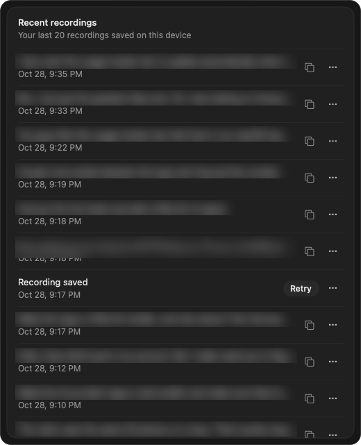

# Transcripts

Mac app that lists your saved ChatGPT dictations so you can find and copy any of them.

The ChatGPT desktop app keeps your recent voice dictations on your Mac, even when one never turns into text. Transcripts shows the last 20, newest first. Copy one with a click, or open ChatGPT to retry a recording that failed.

- Build and open it: `./build.sh` (installs Transcripts.app in `~/Applications`). Needs the Xcode command line tools.
- It only reads `~/.codex/dictation-history` on your Mac. Nothing is sent anywhere.

## License

MIT
